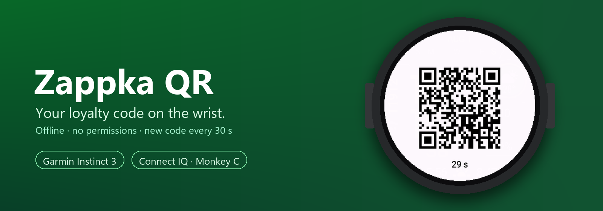
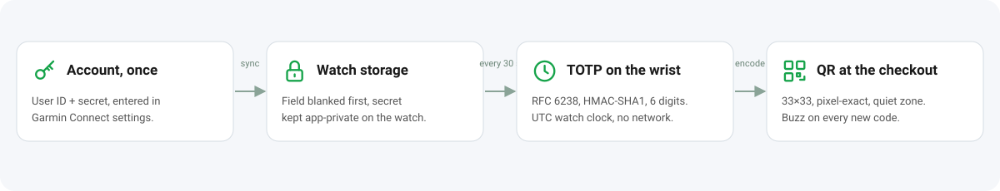
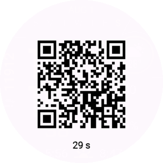
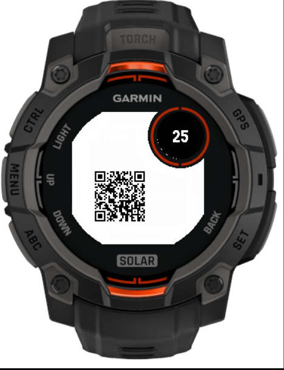
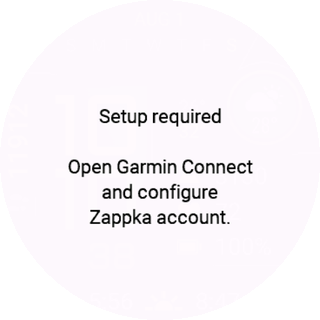

<p align="center">
  
</p>

<p align="center">
  <b>Your Żappka loyalty QR code on a Garmin watch.</b><br>
  Computed on the wrist every 30 seconds, offline, with no phone link at runtime<br>
  and not a single Connect IQ permission.
</p>

<p align="center">
  <a href="CHANGELOG.md"></a>
  
  
  
  
  <a href="LICENSE"></a>
</p>

<p align="center">
  <a href="#how-it-works">How it works</a> ·
  <a href="#features">Features</a> ·
  <a href="#watch-menu">Menu</a> ·
  <a href="#screenshots">Screenshots</a> ·
  <a href="docs/WATCH_SETUP.md">Watch setup</a> ·
  <a href="docs/PROTOCOL.md">Protocol notes</a> ·
  <a href="#build">Build</a>
</p>

> **Independent, unofficial project.** Not affiliated with, endorsed by or connected to Żabka
> Polska. "Żabka" and "Żappka" are trademarks of their owners and are used here only to describe
> compatibility. Use it only with your own account.

---

## Why it exists

At the checkout the phone is in a pocket, a bag or a glove, and the Żappka app needs to be
unlocked, opened and scrolled to the code. The watch is already on the wrist.

Zappka QR shows **the same time-based code as the official app** on a Garmin Instinct 3: one
press from the watch face, hold the wrist to the scanner, done.

It has been in daily use on an **Instinct 3 AMOLED 45 mm** since October 2026: codes are accepted,
points are credited, and a code scanned in the **last seconds** of its 30-second window still works.

## How it works

<p align="center">
  
</p>

<table>
<tr>
<td width="40%" align="center"></td>
<td>

**At the checkout**

1. Open **Zappka QR** from the glance loop. The code is already on the screen.
2. Hold the watch to the scanner. The countdown shows how long the current code lives.
3. Every 30 seconds a **new code** appears exactly at the step boundary, with a short buzz.
4. In the last 2 seconds the countdown turns **inverted**. The code is *not* switched early:
   field use shows that even the last seconds are accepted.
5. Waiting in line? **START** turns on checkout mode: full brightness and a 10-minute timeout.
   If the phone has not been connected for a day, the countdown shows `sync?`: the watch clock
   may have drifted, connect the phone before paying.
6. **MENU** opens the watch menu: checkout mode, buzz on/off, status, sign out, about.

</td>
</tr>
</table>

## Features

<table>
<tr>
<td width="50%" valign="top">

 **No permissions** — the manifest declares none: no network, no background, no positioning. The Connect IQ runtime enforces it.

</td>
<td width="50%" valign="top">

 **Fully offline** — TOTP (RFC 6238, HMAC-SHA1, 30 s) and the QR encoder run on the watch. No backend, no telemetry.

</td>
</tr>
<tr>
<td valign="top">

 **Own QR encoder** — byte mode, ECC M, version 4 (33×33), integer pixel modules, full quiet zone. Bit-identical to Project Nayuki's reference.

</td>
<td valign="top">

 **Built for Instinct 3** — layout computed per screen: octagon and subscreen on Solar, round AMOLED with the countdown below the code.

</td>
</tr>
<tr>
<td valign="top">

 **Safe account changes** — the settings field is blanked first, the secret goes to app-private storage; invalid input keeps the working account; every account change needs confirmation on the watch.

</td>
<td valign="top">

 **Checkout friendly** — buzz on every new code, inverted countdown at the end of a step, checkout mode with maximum backlight, auto-exit to save battery.

</td>
</tr>
<tr>
<td valign="top">

 **Watch menu** — checkout mode, buzz on new code, status with a clock check, sign out with confirmation, about with version and license.

</td>
<td valign="top">

 **Fits every screen** — tests measure each text screen with the watch font against the round AMOLED and the Solar octagon and subscreen.

</td>
</tr>
</table>

## Watch menu

Press **MENU** on the QR screen.

| Item | What it does |
|---|---|
| **Checkout mode** | on/off: maximum backlight, 10-minute timeout (same as **START**) |
| **Buzz on new code** | on/off: short vibration every 30 s when the code changes; remembered |
| **Auto-exit** | 1, 3 or 5 minutes before the app closes itself; remembered |
| **Status** | masked ID, UTC time of the watch, seconds to the next code, when the phone was last seen: quick clock check |
| **Sign out** | asks for confirmation, verifies settings cleanup, then deletes the account from the watch |
| **About** | version, MIT license, unofficial-app note |

## Screenshots

All screenshots are from the Connect IQ simulator with the **public example account** from the
reference project (`123456789012`), not a real account. Both QR codes were decoded and matched an
independent Python TOTP.

| Instinct 3 AMOLED 45 mm | Instinct 3 Solar 45 mm | First start |
|---|---|---|
|  |  |  |
| 6 px modules, countdown below | 2 px modules, countdown in the subscreen | Before account data is entered |

## Watch setup

1. **Get your account data once** (`ployId` and the 64-character hex secret) with the login script
   of [iGerman00/zabka-totp-webapp](https://github.com/iGerman00/zabka-totp-webapp). It signs in
   with your phone number and an SMS code. Read the script before running it.
2. **Install the app**: copy the `.prg` to `GARMIN\APPS` over USB.
3. **Garmin Connect** → device → Connect IQ apps → Zappka QR → Settings: enter the user ID and the
   secret.
4. **Open the app** on the watch. The settings field is blanked and the secret moves into watch
   storage.

Step by step with troubleshooting: [`docs/WATCH_SETUP.md`](docs/WATCH_SETUP.md).

## Supported devices

| Device | Simulator | Real device | Checkout |
|---|---|---|---|
| Instinct 3 AMOLED 45 mm (390×390) | ✅ | ✅ | ✅ daily use since 2026-10 |
| Instinct 3 AMOLED 50 mm (416×416) | ✅ | ⏳ | ⏳ |
| Instinct 3 Solar 45 mm (176×176 MIP) | ✅ | ⏳ | ⏳ (smallest modules, main open risk) |

Another device is one `<iq:product>` line in `manifest.xml`: the layout is computed at runtime from
the screen size, shape and subscreen.

## Build

Requires the Connect IQ SDK (developed with 9.1.0) and a developer key.

```bash
openssl genrsa -out key.pem 4096
openssl pkcs8 -topk8 -inform PEM -outform DER -in key.pem -out developer_key.der -nocrypt
```

```bash
monkeyc -f monkey.jungle -d instinct3amoled45mm -o bin/zappka.prg -y developer_key.der -r
```

Tests run in the simulator (start it first with `connectiq`):

```bash
monkeyc -f monkey.jungle -d instinct3solar45mm -o bin/test.prg -y developer_key.der -t
monkeydo bin/test.prg instinct3solar45mm /t
```

Release builds with commit, SDK version and sha256 per device: `tools/release.sh developer_key.der`
(log in [`docs/RELEASES.md`](docs/RELEASES.md)). It stops if `properties.xml` has a default value,
if the compiler's settings file is missing or non-empty, or if a `.prg` contains anything that looks
like a secret (`tools/check-build.py`).

<details>
<summary><b>Project structure</b></summary>

```text
source/
├── ZappkaApp.mc ZappkaView.mc ZappkaDelegate.mc   app, QR view, buttons
├── crypto/        Hex, TotpGenerator (RFC 6238 + own RFC 2104 HMAC)
├── qr/            QrEncoder (byte mode, v1–10, ECC L/M), QrRenderer (layout, bitmap)
├── storage/       CredentialStore (settings import, sign out), Prefs (menu settings)
├── ui/            ZappkaMenu (menu, sign out, about), TextScreen, CountdownRenderer, ZappkaGlanceView
└── zappka/        ZappkaProtocol (all constants), ZappkaCredentials, ZappkaPayload
tests/             36 simulator tests: RFC vectors, payload, QR vs. Nayuki, layout, settings import,
                   account changes, menu actions, every text screen fits the screen (EN and PL)
resources/         strings (EN), settings, icon        resources-pol/  strings (PL)
tools/             release.sh, check-build.py, check-secrets.py, screenshots.ps1, sim-e2e.sh, build-personal.sh, vault.ps1
docs/              ARCHITECTURE, PROTOCOL, WATCH_SETUP, ON_WATCH_LINKING, ROADMAP, RELEASES, assets/
```

See [`docs/ARCHITECTURE.md`](docs/ARCHITECTURE.md).
</details>

<details>
<summary><b>Implementation notes</b></summary>

- **HMAC:** the SDK's `HashBasedMessageAuthenticationCode` rejects SHA-1, so HMAC (RFC 2104) is built on `Cryptography.Hash` SHA-1.
- **Watchdog:** the Instinct 3 Solar budget per callback is tight. Reed–Solomon uses log tables in one fused loop, the mask is applied during placement, the mask is fixed (0) and layout runs in `onLayout`.
- **Rendering:** the QR is encoded once per 30-second step into a 2-colour `BufferedBitmap`; the 1 s timer only blits it and redraws the countdown.
- **Time:** `Time.now().value()` is UTC epoch seconds, independent of the time zone. Keep the watch clock synced with the phone.
</details>

## Security

- **The secret never leaves the watch at runtime.** No permissions are declared, so the app cannot reach the network.
- **Storage:** Connect IQ has no keystore. The secret lives in `Application.Storage` (app-private, not encrypted by the app). Anyone with developer-level access to the watch filesystem could read it.
- **Provisioning:** settings travel phone → Garmin Connect → watch once. The app blanks the field before anything else.
- **Repository:** no real credentials. Tests and screenshots use the public example account. CI scans every push for secrets.

Details: [`THREAT_MODEL.md`](THREAT_MODEL.md). Reporting: [`SECURITY.md`](SECURITY.md).

## Roadmap

- **v1.0 — released.** Offline QR, checkout mode, settings import that never loses a working account, release provenance.
- **v1.1 — current (rc1).** Watch menu: checkout mode, buzz toggle, status, sign out, about. Compact text screens that fit Solar.
- **v1.2 — next.** Link the account from the watch itself: the SMS code shows up as a watch notification and is entered with the buttons, no computer needed ([`docs/ON_WATCH_LINKING.md`](docs/ON_WATCH_LINKING.md)).
- Field tests on Solar 45 and AMOLED 50.

Full list: [`docs/ROADMAP.md`](docs/ROADMAP.md) · changes: [`CHANGELOG.md`](CHANGELOG.md).

## License

MIT, see [`LICENSE`](LICENSE). Third-party notices: [`THIRD_PARTY.md`](THIRD_PARTY.md).
